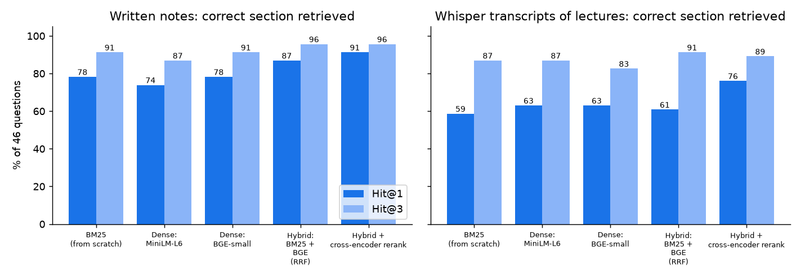
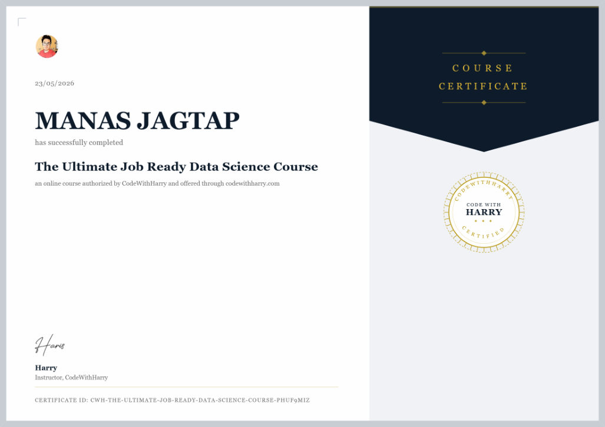

# RAG Teaching Assistant: Ask Questions, Get the Right Lecture and Timestamp

A **retrieval-augmented generation (RAG)** teaching assistant for a course. A student asks a question in plain English, and the assistant finds the passages that answer it. It answers from those passages and says **which lecture video to watch and at what timestamp**.

The pipeline goes from audio to answers:

```
lecture recordings ──Whisper──▶ timed transcripts ──chunk──▶ BM25 + embeddings ──fuse + rerank──▶ top passages ──▶ answer + "Lecture 3 @ 02:24"
```

Project 3 ("RAG-based AI Teaching Assistant") of *The Ultimate Job-Ready Data Science Course* (CodeWithHarry). The demo course is my own 8-week reinforcement-learning notes from [Summer of Science 2026](https://github.com/ManasJ-2007/summer-of-science-rl). I extended the project with:
- BM25 written from scratch
- a comparison of five retrievers, including hybrid fusion and cross-encoder re-ranking
- a labelled question set and evaluation, and a speech-to-text error measurement

## Results (46 hand-labelled student questions)

| | Result |
|---|---|
| **Right section, first result** | **91.3%** with hybrid retrieval + cross-encoder re-ranking, vs 78.3% for BM25 and 73.9% for MiniLM embeddings alone (+13 to 17 points) |
| **Right lecture video, first result**, from Whisper transcripts | **91.3%**, vs 73.9% for BM25 alone. The right section is in the top 3 for 89.1% |
| Mean reciprocal rank (notes) | **0.938** (BM25 0.855) |
| Speech-to-text | 28.9 min of lecture audio transcribed **3.4× faster than real time** on a laptop CPU (Whisper base.en, int8) |
| Latency | 12 ms per query for hybrid retrieval, about 0.5 s with re-ranking (CPU) |

<p align="center"></p>

Full tables (Hit@1/3/5, MRR, lecture-level accuracy and latency for every retriever on both corpora): [`results/retrieval.md`](results/retrieval.md).

**What the numbers show**
- **Lexical and semantic search fail on different questions.**
  - BM25 matches exact terms ("TD error", "Huber loss").
  - Embeddings match paraphrases ("Why does the on-policy agent take a safer route along the cliff?" finds the SARSA section).
  - Fusing them with reciprocal rank fusion beats either alone.
- **Re-ranking matters most on noisy transcripts.** Section Hit@1 rises from 60.9% to 76.1%, because the cross-encoder reads the question and passage together instead of comparing two separate vectors.
- **Spoken lectures are harder than written notes** (76% vs 91% section Hit@1), but the right *video* is still the first result 91% of the time.

## Answers from a local LLM (Llama 3.2 via Ollama)

The retrieved top-3 chunks and the question go to **Llama 3.2 (3B)** running locally with Ollama. The prompt tells it to answer in 2 to 5 sentences **only from the excerpts** and to end with a `Source: Lecture N, section` line. `scripts/evaluate_answers.py` runs all 46 questions and saves every answer to [`results/answers_notes.md`](results/answers_notes.md).

| | Result |
|---|---|
| Answers citing the **correct lecture** | **82.6%** (first prompt version: 60.9%) |
| Answers citing any lecture | 93.5% |
| Correct lecture among the retrieved chunks | 97.8% |
| Median time per answer | 4.4 s on a laptop CPU |

**What changed between the two prompt versions:** the first prompt numbered the excerpts `[1] [2] [3]`, and the 3B model often confused those numbers with lecture numbers or left the citation out. Labelling each excerpt with its lecture and asking for a fixed `Source:` line raised correct citations from 60.9% to 82.6%.

Example (question: *"What does clipping the probability ratio achieve in PPO?"*):
```
Clipping the probability ratio achieves a cheap trust region, so that once the ratio leaves the range
[1-epsilon, 1+epsilon] in the direction that would increase the objective, the gradient is zero. This provides
a cheap way to prevent large policy steps from collapsing performance.

Source: Lecture 6, Week 6: Policy-gradient methods (REINFORCE, A2C, PPO) | PPO: clipped surrogate objective
```

## How it works

| Step | File | What it does |
|---|---|---|
| 1. Speech to text | `rag/transcribe.py` | faster-whisper (Whisper base.en, int8, voice-activity filtering) turns each recording into timed segments |
| 2. Chunking | `rag/chunking.py` | Notes are split per section into 120-word windows (30 overlap). Transcripts are split into 45 s windows (10 s overlap) that keep their start and end times |
| 3a. Lexical retrieval | `rag/retrievers.py` | **Okapi BM25 implemented from scratch** (k1 = 1.5, b = 0.75, with a light stemmer and stop-word list) |
| 3b. Semantic retrieval | `rag/retrievers.py` | Cosine similarity of sentence embeddings (`all-MiniLM-L6-v2`, `bge-small-en-v1.5`) |
| 4. Fusion | `rag/retrievers.py` | Reciprocal rank fusion: score = Σ 1/(60 + rank) |
| 5. Re-ranking | `rag/retrievers.py` | Cross-encoder `ms-marco-MiniLM-L-6-v2` re-scores the top 20 candidates |
| 6. Answer | `rag/generate.py` | A grounded prompt (cite lecture and timestamp, answer only from the excerpts) sent to **Ollama** or any **OpenAI-compatible** API. An offline extractive mode returns the best-matching sentences instead |

### Demo lecture recordings
The repo ships the 8 lecture notes, not videos. `scripts/make_lecture_audio.py` reads each lecture aloud with Windows text-to-speech, producing 28.9 minutes of audio, so the speech-to-text half runs end to end.

Because the audio is generated section by section, the time range of every section is known exactly. That is what makes the section-level labels for transcripts possible. With real lecture videos, point `rag/transcribe.py` at the video folder instead.

**About the 25.6% word error rate:** most "errors" are formula symbols, not misheard words. The script spoke them aloud: "→" becomes "rightward arrow", and LaTeX like `G_t` becomes "G t". Whisper wrote down what it heard, but the comparison text keeps only the plain words. Retrieval still works well on the transcripts.

## Run it

```bash
pip install -r requirements.txt
python ask.py "Why does SARSA take the safer path on CliffWalking?"
python scripts/make_lecture_audio.py           # Windows: create the spoken lectures (~1 min)
python -m rag.transcribe data/audio            # Whisper -> data/transcripts/ (~8 min on CPU)
python ask.py --corpus transcripts "What is the TD error?"
python scripts/evaluate.py                     # retrieval + WER evaluation -> results/
python scripts/evaluate_answers.py             # LLM answers for all 46 questions (needs `ollama pull llama3.2`)
OLLAMA_MODEL=llama3.2 python ask.py --backend ollama "Explain the deadly triad"   # LLM answers
```

Example (from the lecture transcripts):
```
Sources:
  - Lecture 3: Week 3: Dynamic programming and temporal-difference learning @ 02:24-03:09 | Temporal-difference learning
  - Lecture 3: Week 3: Dynamic programming and temporal-difference learning @ 01:47-02:32 | Temporal-difference learning
  - Lecture 5: Week 5: Deep Q-Networks @ 00:40-01:22 | From Q-learning to DQN

From the lectures:
- The bracket delta t equals rt plus 1 plus gamma v, st plus 1, v, st, is the td error. Sursa, q-learning,
  dqn and actor critic all minimize versions of it.
  (Lecture 3 @ 02:24-03:09 | Temporal-difference learning)
```

## Limitations
- The corpus is small (8 lectures, about 50 chunks), and I wrote the 46 questions myself. A larger course and questions from real students would be a stronger test.
- Answer quality is checked only partly: citations are scored automatically, and I read a sample of answers by hand. Most were correct, but the 3B model sometimes blends details (one answer called the DQN loss both squared error and Huber). A larger model or an LLM judge would give a stronger test of faithfulness.
- The extractive fallback copies sentences verbatim, so formulas from transcripts read awkwardly. Use an LLM backend for fluent answers.

## Files

| Path | Purpose |
|---|---|
| `rag/` | Transcription, chunking, retrievers, answer generation |
| `ask.py` | Command-line assistant (single question or interactive) |
| `data/lectures/` | Lecture notes (8 weeks of reinforcement learning) |
| `data/transcripts/` | Whisper transcripts with timestamps and section times |
| `eval/questions.json` | 46 labelled questions (lecture + section) |
| `scripts/evaluate.py` | Retrieval, latency and WER evaluation |

---
<p align="center"></p>

Manas Jagtap · IIT Bombay · Certificate: The Ultimate Job-Ready Data Science Course, CodeWithHarry (May 2026)
